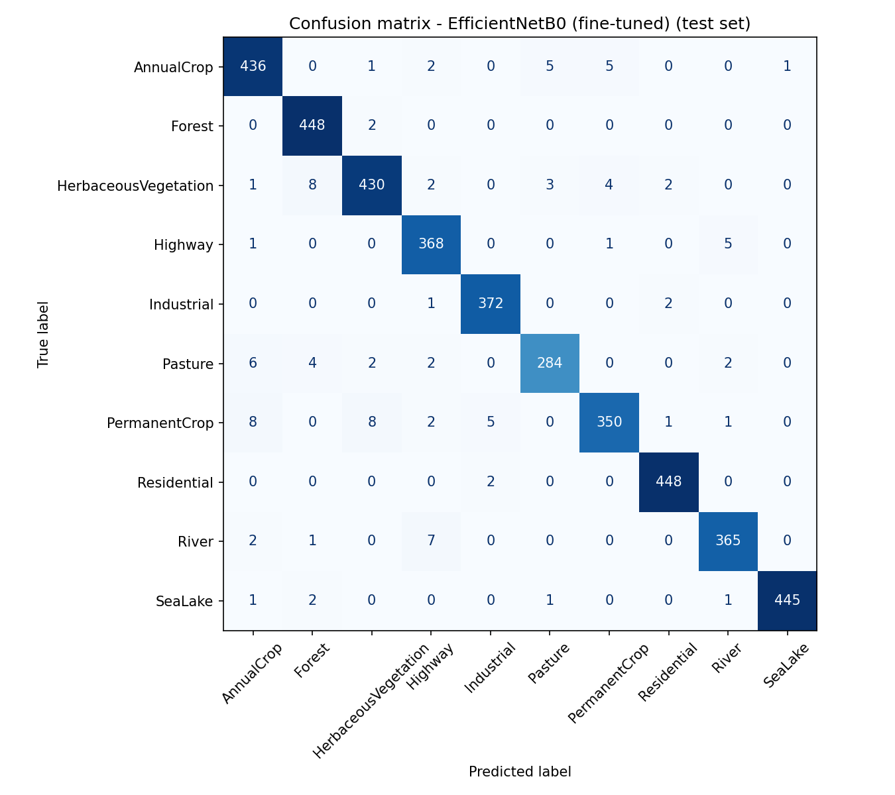
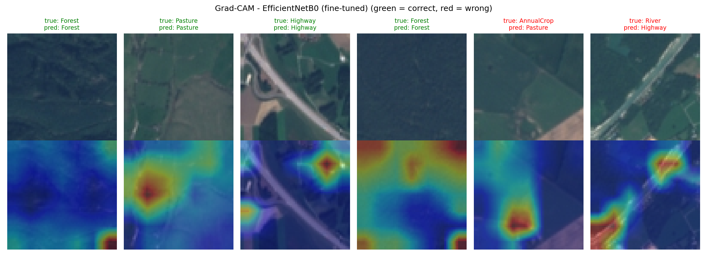

# Land-Cover Classification on EuroSAT

Classification of Sentinel-2 satellite images into 10 land-cover classes with TensorFlow/Keras.
I compare a CNN trained from scratch, the same CNN with data augmentation, and a fine-tuned EfficientNetB0, then analyse the errors and the Grad-CAM explanations of the best model.

## Dataset

[EuroSAT](https://github.com/phelber/eurosat) (RGB version): 27,000 Sentinel-2 image patches of 64×64 pixels in 10 classes (AnnualCrop, Forest, HerbaceousVegetation, Highway, Industrial, Pasture, PermanentCrop, Residential, River, SeaLake). The images are downloaded from [Zenodo](https://zenodo.org/records/7711810) and split 70/15/15 into train/validation/test (stratified, fixed seed).

## Approach

- **Baseline CNN**: 4 Conv2D + MaxPooling blocks, dropout and a dense head, trained from scratch on 64×64 images.
- **CNN + augmentation**: the same CNN with random flips and rotations.
- **EfficientNetB0**: ImageNet weights, 224×224 inputs. The new head is trained first with the base frozen, then the top layers are fine-tuned with a lower learning rate.

## Results (test set, 4,050 images)

| Model | Test accuracy | Macro F1 |
|---|---|---|
| Baseline CNN | 0.8899 | 0.8853 |
| CNN + augmentation | 0.8667 | 0.8640 |
| EfficientNetB0 (fine-tuned) | **0.9743** | **0.9735** |

Confusion matrix and Grad-CAM of the best model (EfficientNetB0):

## Key takeaways

- Transfer learning gives the best results by far: 0.9743 test accuracy, against 0.8899 for the best CNN trained from scratch.
- Data augmentation did not help within 15 epochs (0.8667). Its validation loss was still going down at the last epoch, so the augmented model needed more training rather than more regularization.
- 57 of the 104 test errors of EfficientNetB0 are between the five vegetation classes (crops, pasture, herbaceous vegetation, forest), and 12 are between Highway and River.
- Grad-CAM heatmaps are coarse (7×7 feature map) and do not always focus on the object a human would use, so they are a rough hint rather than an explanation.

## How to run

- **Colab**: open [eurosat_landcover.ipynb](https://colab.research.google.com/github/asmakhomsi/eurosat-land-cover-classification/blob/main/eurosat_landcover.ipynb), select a GPU runtime (T4) and run all cells.
- **Locally**: `pip install -r requirements.txt`, then open `eurosat_landcover.ipynb` in Jupyter. A GPU is strongly recommended.
